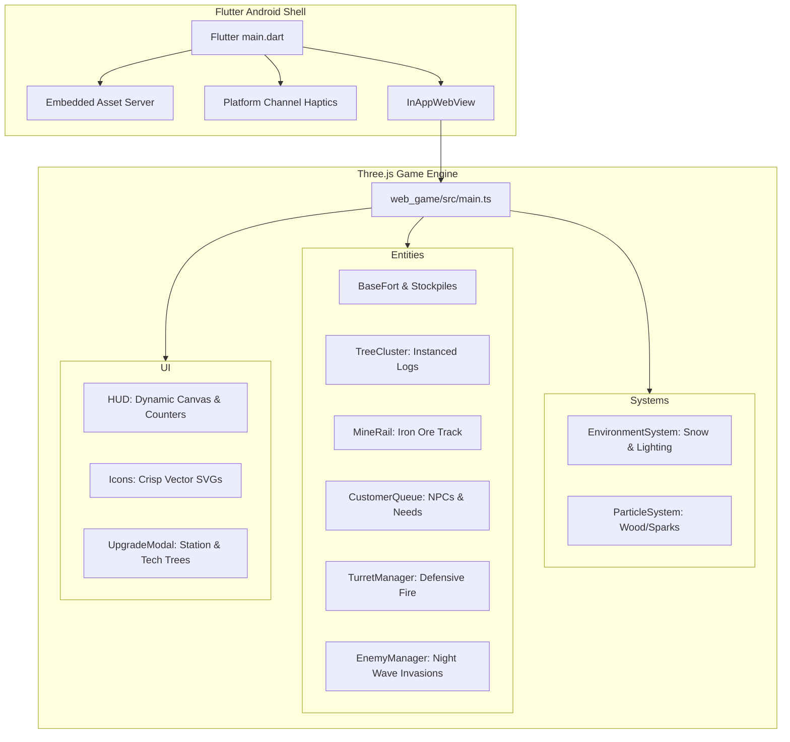

# Frostbound Outpost — Architecture & Milestone Roadmap

## 1. Overview
Frostbound Outpost is a mobile-first 3D survival base-builder set in a low-poly frozen frontier. Players explore the tundra, chop timber, gather ore, feed hungry survivors, build defenses, and repel nightly frost beast waves.

The project is structured as a dual-stack hybrid:
1. **Core 3D Engine (`web_game/`):** Built with TypeScript, Vite, and Three.js. Employs hardware-accelerated instanced rendering (`THREE.InstancedMesh`), procedural geometries, object pooling, and WebAudio SFX.
2. **Native Android Shell (`lib/`, `android/`):** Built with Flutter, wrapping the local game engine via `flutter_inappwebview` with an offline embedded asset server and native Android haptic feedback bridging.

---

## 2. System Architecture

---

## 3. Milestone Completion Roadmap

### Phase M: Core Gameplay Mechanics (M1 – M6)
- **M1 — Scene & Touch Controls:** Isometric low-poly camera, responsive virtual touch joystick, character movement controller.
- **M2 — Chopping & Stack Carry:** Axe swing animations, timber node destruction, physical stack carry system on character back.
- **M3 — Base Stations & Rail Delivery:** Sawmill processing, mine cart rails, resource deposit zones.
- **M4 — Defense & Turrets:** Automated arrow turrets, target tracking, enemy pathing, base health bar.
- **M5 — NPC Queue & Station Unlocks:** Wandering survivors requesting rations/supplies, coin rewards, progressive station unlock gates.
- **M6 — Survival Progression & Wave Loops:** Day/night clock, escalating nightly blizzard waves, station upgrade system.

### Phase G: Stylized Visual Polish (G1 – G4)
- **G1 — Lighting & Atmospheric Fog:** Cold blue ambient light, warm lantern accents, volumetric snow drift particles.
- **G2 — Low-Poly Character Overhaul:** Instanced enemy rigs, stylized survivor silhouettes, fluid walk cycles.
- **G3 — Props & Outpost Fortifications:** Instanced timber palisades, guard watchtowers, snowbanks, optimized draw call budget.
- **G4 — HUD & Vector UI Polish:** Replaced all legacy emojis with crisp inline SVG icons, local Inter typography, notch-safe insets, and browser lifecycle pause/resume handlers.

---

## 4. Verification & Quality Gates
- **Unit & Logic Tests (`web_game/tests/`):** Vitest runner covering inventory capacities, turret range calculations, customer queue timeouts, and SVG icon generators.
- **Type Safety (`tsc --noEmit`):** Full TypeScript compilation without emission.
- **Flutter Analysis (`flutter analyze lib`):** Strict linting with zero issues.
- **Performance Budget:** Maximum 45 draw calls in default viewport on mobile GPUs.
